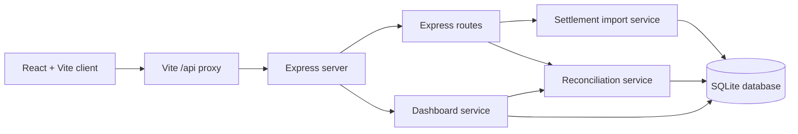

# Architecture

## Overview

The system is a small full-stack application:

- The React/Vite client presents dashboards, transactions, reconciliation upload,
  issues, reports, and read-only settings.
- Express exposes health, transaction, reconciliation, and dashboard endpoints.
- Services perform CSV validation/import and reconciliation calculations.
- SQLite stores transactions and settlement history through `better-sqlite3`.

## Request flow

In development, Vite proxies `/api` requests from the client to the backend at
`http://localhost:3000`. The client uses the shared fetch helpers in
`Frontend/client/src/api/httpClient.ts`.

The backend starts in `src/server.ts`, initializes the SQLite connection, mounts
transaction and reconciliation routes, and exposes health and summary handlers.
The database connection resolves `reconciliation.db` relative to the process
working directory and executes `src/database/schema.sql` if tables are missing.

## Settlement CSV flow

`POST /api/reconcile` accepts one multipart file under the field name `file`.
Multer limits uploads to one `.csv` file of at most 5 MB and stores it in memory.
The route passes the UTF-8 contents to `importSettlementCsv`.

The import service:

1. Parses the required CSV columns.
2. Validates IDs, dates, positive amounts, `DEBIT`/`CREDIT` type, and three-letter
   currency values.
3. Rejects duplicate settlement IDs.
4. Matches by lifecycle ID first.
5. Falls back to account ID, normalized merchant name, and transaction date.
6. Rejects unmatched rows and currency mismatches.
7. Inserts accepted rows into `settlement_history` in one database transaction.

After import, the route runs the existing reconciliation service and returns
both the import summary and per-transaction reconciliation results.

## Reconciliation flow

The reconciliation service reads every transaction and aggregates its settlement
history:

`net settlement = total DEBIT - total CREDIT`

It determines the settlement status from transaction status, settlement count,
net amount, and whether credits exist. It also reports inactive transactions with
settlements, over-settlement, overdue pending settlement, and non-refund partial
settlement issues. The service updates the transaction's stored settlement
status, net amount, and latest settlement date in a database transaction.

The dashboard service reuses reconciliation results for status and issue counts,
and reads completed transaction totals from SQLite. The client Reports and Issues
pages consume these backend responses; they do not reimplement reconciliation
rules.

